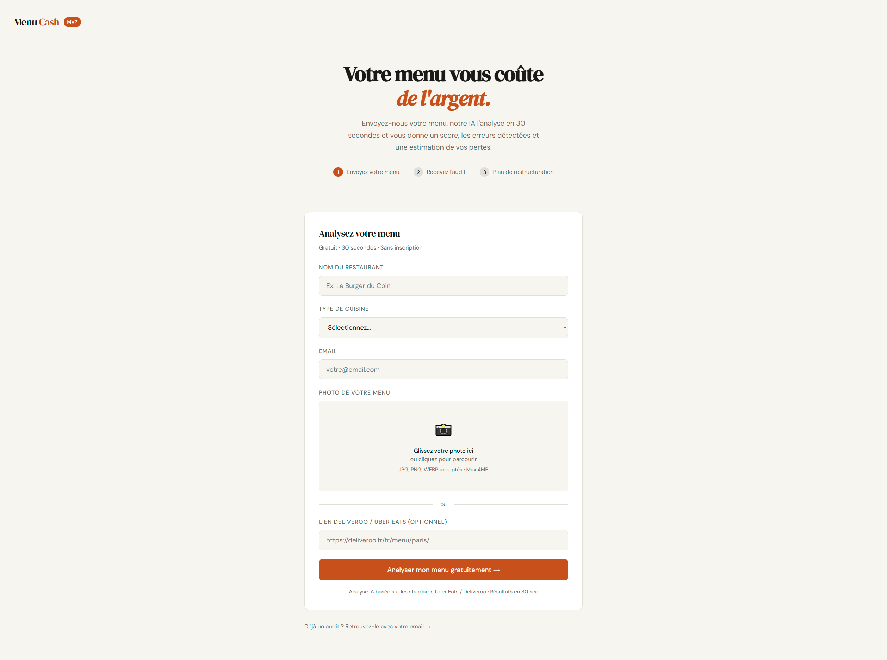
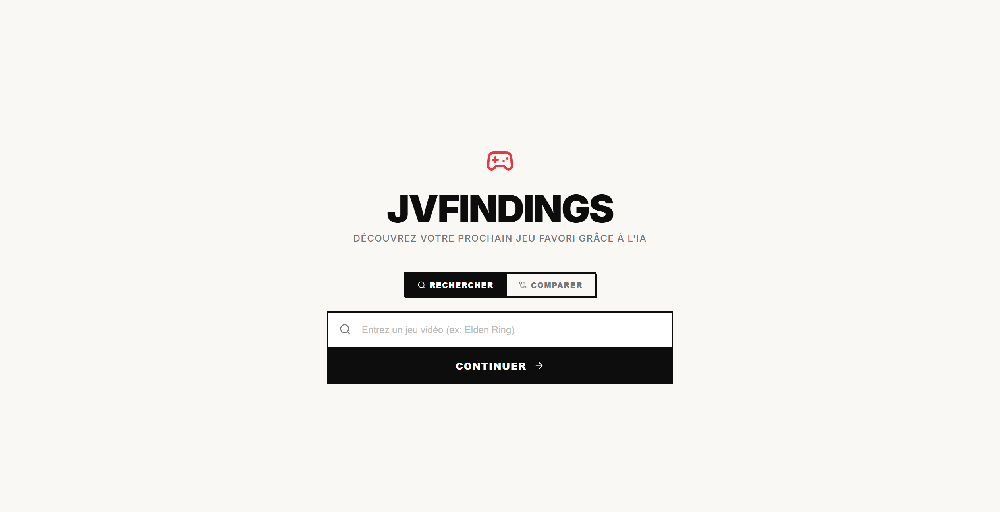

<!-- Bannière -->

  

  

  
  
  

---

## 👋 Salut, moi c'est Lyam

Développeur **Fullstack & IA** en alternance à l'**EPSI Rennes** (Bachelor Concepteur Développeur d'Applications).
Je conçois des produits web qui intègrent l'IA de bout en bout : **de l'API au déploiement**.

- 🧠 J'aime transformer un modèle (LLM, embeddings, vision) en **vrai produit** utilisable
- ⚙️ Freelance en **automatisation IA** : workflows n8n / Make connectés à des LLMs et APIs métier
- 🐳 Je déploie moi-même : Docker, VPS, Coolify, Nginx
- 🎯 En recherche d'une **alternance Mastère IA & Data** — rentrée **septembre 2027**
- 🌐 Tout le reste est sur **[lyamml.fr](https://lyamml.fr)** (c'est un tableau infini, va zoomer dessus 👀)

---

## 🚀 Projets à la une

<table>
  <tr>
    <td width="45%"></td>
    <td valign="middle">
      <h3>🍽️ MenuCash</h3>
      SaaS d'audit de menu par IA. Une photo du menu → score, erreurs et pertes de revenus estimées, puis un plan de restructuration payant.
        
      <code>GPT-4.1-mini Vision</code> <code>Stripe</code> <code>Supabase</code> <code>Docker</code>
        
      <a href="https://menucash.lyamml.fr"><b>▶ Démo live</b></a> · <a href="https://github.com/LyamML/MenuCash">Code</a>
    </td>
  </tr>
  <tr>
    <td valign="middle">
      <h3>🎮 JVFindings</h3>
      Recommandation de jeux vidéo par embeddings. Chaque jeu devient un vecteur sémantique, classé par similarité cosinus.
        
      <code>Next.js 16</code> <code>OpenAI Embeddings</code> <code>TypeScript</code>
        
      <a href="https://jvfindings.lyamml.fr"><b>▶ Démo live</b></a>
    </td>
    <td width="45%"></td>
  </tr>
</table>

Et aussi : 🧩 <b>Nexus</b> (RAG + pgvector) · 🗺️ <a href="https://lyamml.fr"><b>lyamml.fr</b></a> — tous les projets sont sur le portfolio.

---

## 🛠️ Stack

<table>
  <tr>
    <td align="right" width="150"><b>Front</b></td>
    <td></td>
  </tr>
  <tr>
    <td align="right"><b>Back-end</b></td>
    <td></td>
  </tr>
  <tr>
    <td align="right"><b>IA & Data</b></td>
    <td></td>
  </tr>
  <tr>
    <td align="right"><b>Données</b></td>
    <td></td>
  </tr>
  <tr>
    <td align="right"><b>Infra & Auto</b></td>
    <td></td>
  </tr>
  <tr>
    <td align="right"><b>Sécurité</b></td>
    <td><code>OWASP Top 10</code> <code>Security by Design</code> <code>STRIDE</code> <code>Burp Suite</code> <code>Wireshark</code></td>
  </tr>
</table>

---

## 🏅 Certifications

  
  
  
  
  
  
   
  
  

---

## 📊 Stats

  
  

  

---

  <b>Un projet, une alternance, une idée d'automatisation ?</b> 
  👉 <a href="https://lyamml.fr">lyamml.fr</a> — on en parle.

